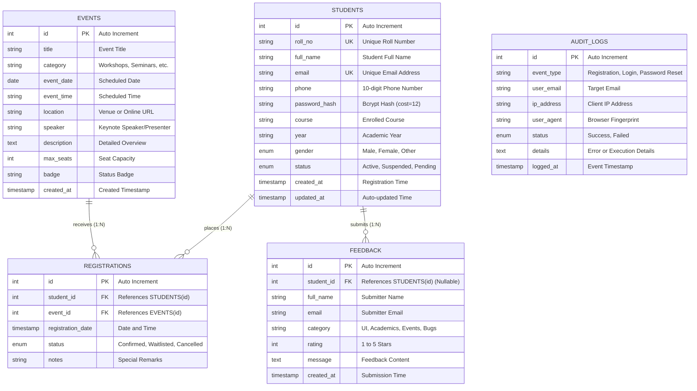

# StudentHub Portal - Entity Relationship (ER) Model
**Practical 8: Normalized Database Design (3NF)**

## 1. Relational Entities and Cardinality

The StudentHub schema is normalized to Third Normal Form (3NF) to eliminate transitive dependencies and data anomalies.

- **`students`**: Stores registered student credentials, contact info, and course details.
- **`events`**: Stores upcoming workshops, seminars, and campus tech events.
- **`registrations`**: Associative bridge entity resolving the **Many-to-Many ($M:N$)** relationship between `students` and `events`.
- **`feedback`**: Stores student ratings and system reviews (1-to-Many from `students`).
- **`audit_logs`**: Tracks authentication, registration security events, IP addresses, and timestamps.

## 2. Mermaid Entity-Relationship Diagram

## 3. Relational Schema Attributes & Constraints

| Table | Primary Key | Foreign Keys | Constraints & Indexes |
|---|---|---|---|
| `students` | `id` | None | `roll_no` (UNIQUE), `email` (UNIQUE), INDEX(`course`) |
| `events` | `id` | None | INDEX(`event_date`), INDEX(`category`) |
| `registrations` | `id` | `student_id` $\rightarrow$ `students(id)` `event_id` $\rightarrow$ `events(id)` | UNIQUE(`student_id`, `event_id`), `ON DELETE CASCADE` |
| `feedback` | `id` | `student_id` $\rightarrow$ `students(id)` | `rating BETWEEN 1 AND 5`, `ON DELETE SET NULL` |
| `audit_logs` | `id` | None | INDEX(`user_email`), INDEX(`logged_at`) |
