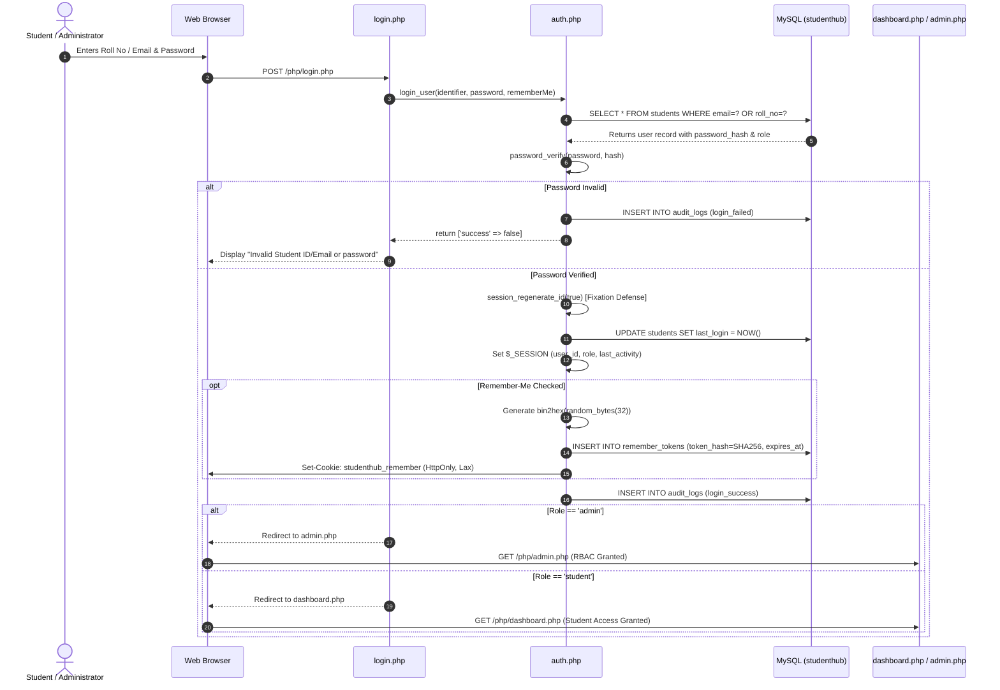

# Practical 10: Secure Login/Logout with Sessions, Role-Based Access, Timeout, and Remember-Me Token

**Course:** Web Development Fundamentals / Frameworks  
**Subject Code:** WDF Lab  
**Student ID:** 24IT055 / 25IT055 (Smeet Nakrani)  
**Tools & Environment:** PHP 8+, MySQL (MariaDB), Apache (XAMPP), Browser DevTools  
**CO Mapping:** CO1, CO5  

---

## 1. Problem Definition & Objectives

Develop an enterprise-grade, secure authentication and session management subsystem for the **Students Hub Portal** complying with OWASP guidelines:
1. **Secure Session Management:** Start and destroy sessions securely using strict cookie configurations (`HttpOnly`, `SameSite=Lax`, `Secure`).
2. **Password Verification:** Authenticate stored Bcrypt hashes via `password_verify()`.
3. **Session Fixation Prevention:** Regenerate session IDs (`session_regenerate_id(true)`) upon privilege elevation.
4. **Access Control & RBAC:** Restrict dashboard access so unauthorized/unauthenticated guests are blocked, students access `dashboard.php`, and only administrators can access `admin.php`.
5. **Inactivity Session Timeout:** Automatically invalidate sessions and redirect after a period of user inactivity (default: 15 minutes; with configurable test triggers).
6. **Intermediate Extension:** Record and display the `last_login` timestamp for users.
7. **Advanced Extension:** Implement persistent "Remember-Me" authentication using cryptographically strong random tokens whose SHA-256 hashes are stored in the database, avoiding custom JWT-like tokens.

---

## 2. Key Questions & Theoretical Analysis

### Question 1: Are sessions started and destroyed securely?
**Implementation & Security Architecture:**
* **Session Initialization (`init_secure_session` in [auth.php](file:///e:/StudentHub-main/php/auth.php)):**
  ```php
  session_set_cookie_params([
      'lifetime' => 0,              // Cleared when browser session ends
      'path'     => '/',
      'domain'   => '',
      'secure'   => $isSecure,      // Transmitted only via HTTPS
      'httponly' => true,           // Prevents XSS script access to session cookie
      'samesite' => 'Lax'           // Defends against Cross-Site Request Forgery (CSRF)
  ]);
  ini_set('session.use_only_cookies', '1');  // Disallows session IDs in URL query parameters
  ini_set('session.use_strict_mode', '1');   // Rejects uninitialized session IDs
  session_start();
  ```
* **Session Destruction (`logout_user` in [auth.php](file:///e:/StudentHub-main/php/auth.php) & [logout.php](file:///e:/StudentHub-main/php/logout.php)):**
  1. `$_SESSION = []` unsets all session variables from server memory.
  2. If session cookies are used, `setcookie(session_name(), '', time() - 42000, ...)` forces client browsers to purge the cookie immediately.
  3. `session_destroy()` invalidates the session file on the web server.
  4. Active Remember-Me tokens are simultaneously deleted from the `remember_tokens` MySQL table and client cookies.
  5. The event is recorded in the `audit_logs` table for compliance.

---

### Question 2: Is `password_verify()` used correctly?
**Analysis:**
* Plaintext passwords must never be stored, compared with `==`, or re-hashed using fast algorithms (e.g. MD5, SHA-1, or raw SHA-256).
* The user's stored hash was created with `password_hash($pwd, PASSWORD_BCRYPT, ['cost' => 12])`.
* In `login_user()`:
  ```php
  $stmt = $pdo->prepare("SELECT * FROM students WHERE email = :id1 OR roll_no = :id2 LIMIT 1");
  $stmt->execute([':id1' => $identifier, ':id2' => $identifier]);
  $user = $stmt->fetch();

  if (!$user || !password_verify($password, $user['password_hash'])) {
      log_audit_event('login_failed', $identifier, 'Failed', 'Invalid credentials');
      return ['success' => false, 'message' => 'Invalid Student ID/Email or password.'];
  }
  ```
* `password_verify()` extracts the embedded algorithm identifier (`$2y$`), cost factor (`12`), and 22-character salt directly from the hash string, applies key derivation, and performs constant-time comparison to prevent timing attacks.

---

### Question 3: Is unauthorized dashboard access blocked?
**Analysis:**
* Both `dashboard.php` and `admin.php` call `require_auth(?string $requiredRole)` before rendering any HTML.
* If `$_SESSION['user_id']` is absent:
  1. Checks if a persistent `studenthub_remember` cookie exists.
  2. If invalid or missing, blocks access, logs `unauthorized_access` in `audit_logs`, and issues an HTTP 302 redirect to `login.php?msg=unauthorized` (or HTTP 401 for AJAX requests).
* If a logged-in student attempts to access `admin.php`:
  1. `require_auth('admin')` checks `$_SESSION['role'] === 'admin'`.
  2. Fails the assertion because the student has role `'student'`.
  3. Logs `rbac_privilege_violation` to `audit_logs`.
  4. Redirects the student back to `dashboard.php?msg=admin_denied` with an error message.

---

### Question 4: Is session timeout implemented?
**Analysis:**
* Web applications must prevent session hijacking when users leave shared or university lab terminals unattended.
* In [auth.php](file:///e:/StudentHub-main/php/auth.php):
  ```php
  function enforce_session_timeout(): void {
      if (isset($_SESSION['user_id'])) {
          $timeout = $_SESSION['session_timeout'] ?? DEFAULT_SESSION_TIMEOUT; // 900 seconds (15 min)
          $inactiveSeconds = time() - ($_SESSION['last_activity'] ?? time());

          if ($inactiveSeconds > $timeout) {
              log_audit_event('session_timeout', $_SESSION['email'], 'Success', 'Timeout reached');
              logout_user(false);
              header("Location: login.php?msg=timeout");
              exit;
          }
          $_SESSION['last_activity'] = time(); // Reset timestamp upon legitimate activity
      }
  }
  ```
* Both the Student Dashboard ([dashboard.php](file:///e:/StudentHub-main/php/dashboard.php)) and Admin Console ([admin.php](file:///e:/StudentHub-main/php/admin.php)) display a live countdown timer that syncs with `session_status.php`.
* A **"Test 10-Second Timeout"** button allows faculty and students to test and screenshot inactivity timeout behavior immediately without waiting 15 minutes.

---

### Question 5: Are admin and student users redirected to appropriate dashboards?
**Analysis:**
* Upon successful credential verification in `login_user()`:
  ```php
  $redirectUrl = ($_SESSION['role'] === 'admin') ? 'admin.php' : 'dashboard.php';
  ```
* **Student User** (`24IT055` / `Password@123`): Redirected to `dashboard.php` with student courses, progress, attendance, and session inspector.
* **Administrator User** (`admin@studentshub.edu` / `Password@123`): Redirected to `admin.php` with system metrics, user role directory, and live security audit logs.

---

## 3. Architecture & Authentication Lifecycle (Mermaid)



---

## 4. Advanced & Intermediate Extensions

### Intermediate Extension: Last-Login Timestamp
* **Database Column:** `ALTER TABLE students ADD COLUMN last_login DATETIME NULL;`
* **On Login:** The previous login timestamp is retrieved, stored in `$_SESSION['last_login']`, and the database is updated with `NOW()`.
* **Dashboard Display:** Displayed in the Session & RBAC Inspector card so students can verify recent account activity.

### Advanced Extension: Remember-Me Token Hash in Database
* **Vulnerability in Custom JWTs/Plain Cookies:** Custom base64 tokens or unhashed database tokens can be forged or stolen if the database is leaked.
* **Our Implementation:**
  1. Generate 32 bytes (256 bits) of cryptographically secure randomness: `$rawToken = bin2hex(random_bytes(32));`
  2. Compute SHA-256 hash: `$tokenHash = hash('sha256', $rawToken);`
  3. Store `$tokenHash`, `$userId`, and expiration date (30 days) in `remember_tokens` table.
  4. Send cookie containing `base64(userId:rawToken)` with `HttpOnly`, `SameSite=Lax`, and `Secure`.
  5. **Token Rotation:** When validating the cookie, the used token is deleted and replaced with a newly generated token, defeating replay attacks.

---

## 5. Post-Laboratory Submission & Screenshot Guide

To complete lab evaluation, capture screenshots of the following 5 scenarios:

| Screenshot # | Scenario | How to Produce & Capture in StudentHub Portal |
|---|---|---|
| **Screenshot 1** | **Login Success & Dashboard** | 1. Open `http://localhost/StudentHub-main/php/login.php`.<br>2. Click **👨‍🎓 Student: 24IT055** demo button.<br>3. Click **Sign In Securely**.<br>4. Capture the authenticated Student Dashboard showing **Assigned Role (STUDENT)**, your name, and session ID. |
| **Screenshot 2** | **Failed Login Attempt** | 1. Open `php/login.php`.<br>2. Enter roll number `24IT055` with an incorrect password (e.g., `WrongPass999`).<br>3. Submit the form.<br>4. Capture the red error banner: *"Invalid Student ID/Email or password. Please verify your credentials."* |
| **Screenshot 3** | **Unauthorized Access Block** | 1. Log out or open an Incognito window.<br>2. Try directly accessing `http://localhost/StudentHub-main/php/dashboard.php`.<br>3. Capture the redirect to `login.php?msg=unauthorized` displaying the red alert banner: *"Access Denied: Please sign in to access the protected dashboard."* |
| **Screenshot 4** | **Inactivity Session Timeout** | 1. Sign in as student `24IT055`.<br>2. In the Session Inspector card, click **⏳ Test 10-Second Timeout**.<br>3. Wait 10 seconds without interacting.<br>4. Capture the redirect to `login.php?msg=timeout` displaying the amber warning banner: *"Your session has expired due to inactivity. Please sign in again."* |
| **Screenshot 5** | **RBAC Privilege Enforcement** | 1. Sign in as student `24IT055`.<br>2. Click **⛔ Test Unauthorized Admin Access (RBAC Block)**.<br>3. Capture the redirected dashboard showing the red alert box: *"Role-Based Access Control Blocked: You attempted to access the Administrator Console... recorded in security audit log."* |

---

## 6. Viva-Voce Questions & Model Answers

### Q1: Why must `session_regenerate_id(true)` be called immediately after login?
**Answer:** To defend against **Session Fixation** attacks. In session fixation, an attacker tricks an unauthenticated victim into using a known session ID (e.g. via a malicious link). If the application elevates privileges without generating a new ID, the attacker can hijack the session using the fixed ID. `session_regenerate_id(true)` issues a new session identifier and deletes the old unauthenticated session file.

### Q2: What is the purpose of `HttpOnly` and `SameSite` flags on session cookies?
**Answer:** 
* `HttpOnly`: Instructs the browser that the cookie cannot be accessed via JavaScript (`document.cookie`), preventing cookie-theft via Cross-Site Scripting (XSS).
* `SameSite=Lax`: Restricts cookie transmission on cross-origin requests, defending against Cross-Site Request Forgery (CSRF).

### Q3: Why do we store the SHA-256 hash of the remember-me token rather than the plaintext token?
**Answer:** Per OWASP security guidelines, if an attacker gains unauthorized read access to the database (e.g. through SQL injection or a database backup breach), unhashed tokens could immediately be used to forge persistent login cookies. By storing `hash('sha256', $rawToken)`, the attacker only sees irreversible hashes and cannot construct valid cookies.

### Q4: How does `password_verify()` resist timing attacks?
**Answer:** `password_verify()` performs a **constant-time byte comparison** between the newly computed hash and the stored hash. Unlike standard string comparisons (`===` or `strcmp()`), which return false on the first mismatched character (leaking timing information), constant-time execution takes identical duration regardless of where differences occur.

### Q5: What is the difference between client-side session timeout and server-side session timeout?
**Answer:** Client-side timeout (e.g., JavaScript countdown) is purely for User Experience (UX), alerting the user and redirecting them when inactive. Server-side timeout (`time() - $_SESSION['last_activity'] > 900`) is the **authoritative security boundary**; even if a malicious user bypasses the frontend JS, the server rejects expired session requests and destroys server-side data.
